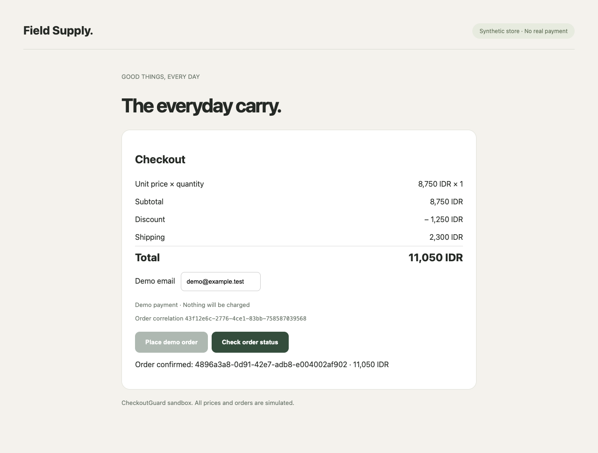
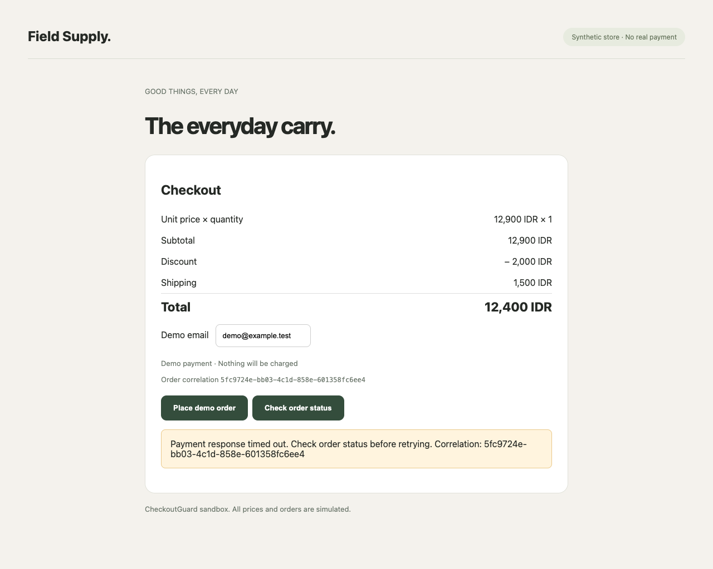

# CheckoutGuard evidence for reviewers

Team **FLdevBoo** · [public repository](https://github.com/fadillaoegi/checkoutGuard).
These are synthetic sandbox orders. Model decisions, Chrome actions and
PostgreSQL verification were real; no marketplace purchase was made.

| Case | Result | Expected / displayed | Orders / submits | Duration |
|---|---|---|---|---|
| Pricing defect | Verified finding | 9,800 / 11,050 IDR | 1 / 1 | 21.30 s |
| Corrected retest | Passed | 9,800 / 9,800 IDR | 1 / 1 | 28.92 s |
| Payment timeout | Passed after checking saved orders | 12,400 / 12,400 IDR | 1 / 1 | 16.66 s |

The pricing calculation is **8,750 − 1,250 + 2,300 = 9,800 IDR**. The defective
fixture displays 11,050 IDR. Retest keeps the same goal and basket and selects
the corrected fixture; the agent does not edit a merchant's source code.

## Browser evidence

The exported PNGs are byte-for-byte copies of final browser evidence. All
32 screenshots across these four runs were checked for PNG signatures and
HTTP MIME. Only these four reviewed sandbox images are published; private
browser profiles, raw runs, model inputs and account screenshots stay ignored.

### Pricing defect



### Corrected retest


### Payment timeout recovery



The last screenshot deliberately retains the original timeout message. The
`order_status` tool checks PostgreSQL directly, confirms one saved order under
the original correlation ID, and the agent finishes without another submit.
This demonstrates payment timeout recovery, not recovery from an unavailable
model provider.

## Hosted neatlogs readback

| Case | Trace ID | Readback |
|---|---|---|
| Pricing defect | `000d9deb6a723905d68a787ae9926c4f` | [verified summary](evidence/pricing-defect-trace.json) |
| Corrected retest | `7a97b78bbc758fb1cbadf231ccb0f210` | [verified summary](evidence/corrected-retest-trace.json) |
| Payment timeout | `94f12c0013ff1e04832776d908767f78` | [verified summary](evidence/payment-timeout-trace.json) |

Each trace had 15 spans: one root, seven LLM calls, and seven tools. Hosted
hierarchy, input/output availability and provider-reported token totals matched
local records. A successful defect-detection workflow still has application
status `findings`; it does not imply the displayed amount is correct.

[Run summaries](evidence/runs.json) preserve the original unknown recorded cost
and separately label posthoc estimates from the public model catalog. Those
estimates are not verified invoices. [SHA-256 manifest](evidence/manifest.json)
identifies the published artifacts; it is an integrity record, not a provider
signature. Reviewer-accessible hosted trace URLs/screenshots still need to be
added from the project dashboard before final submission.

## Cost-observability improvement

The earlier corrected retest recorded cost as unknown. After configuring rates
for the exact provider/returned label, a new retest of the same baseline/goal/
basket passed with one order, 12,361 input + 199 output tokens, and an estimate
of **US$0.00318975**: `(12,361 × 0.25 + 199 × 0.50) / 1,000,000`.
The published catalog was checked on 11 October 2026. This is a known-usage
estimate, not an invoice; missing request usage remains unknown and partial
totals are labelled. Historical records were not rewritten.

Trace `db1fd6a1e4cb8d7159c6cefc1c0b3daa` was read back with 15 valid spans and
matching token totals. [Verified summary](evidence/priced-retest-trace.json) ·
[Original screenshot](evidence/priced-retest.png).

This before/after evidence measures observability, not inference speed or a
reduction in cost: the provider-reported token counts differ. Actual feature
commit/checkpoint provenance remains pending user publication.

## Model identity and reliability

The configured provider was Public AI; requests selected
`swiss-ai/apertus-v1.5-70b`, while responses were labelled
`aisingapore/Qwen-SEA-LION-v4-32B-IT`. We report both and do not claim independent
verification of model weights or successful Apertus inference. These three runs
had no model timeouts; previous failed runs remain documented in
[EVALUATION.md](../docs/EVALUATION.md). Provider reliability is still unresolved.

## Reproduction

Follow the [README](../README.md) to configure private local credentials and
start PostgreSQL, backend and dashboard. Run an incorrect-total check with
the alternate basket, then select **Retest corrected store**. For payment
timeout choose the standard basket. The agent chooses the browser actions;
the scripts only start/poll runs and verify actual results.

```sh
node scripts/check-model-reliability.mjs timeout
node scripts/check-model-reliability.mjs --retest YOUR_BASELINE_RUN_ID
```

Published run IDs belong to the author's local database. A new clone starts
with its own run IDs; do not expect these historical runs to appear in an empty
database. Evidence and safe summaries above remain inspectable without the DB.

## Competition status

Runtime evidence is ready. Entire prerequisites pass, but the feature checkpoint
and public commit still require verification after the user publishes the code.
Actual cfo.ai output, demo video, building-in-public links and the official X
quote submission remain pending. See [SUBMISSION-CHECKLIST.md](SUBMISSION-CHECKLIST.md).
